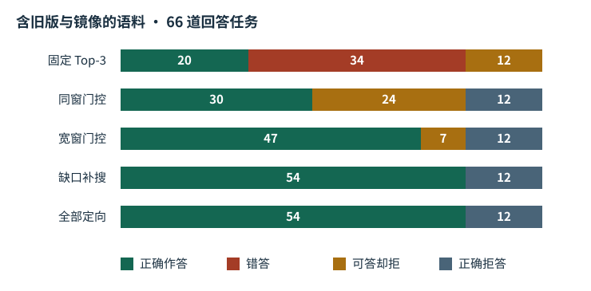

# AI 时代下的搜索技术——以 RAG 为例

**从返回相关链接，到检验这些证据能否支持一个回答**

> **公开 GitHub 仓库**　[jianghai0725/-](https://github.com/jianghai0725/-)  
> **对话与复核**　[搜索技术演变史完整对话](chat/搜索技术演变史_完整对话.md) · [复现入口](README.md)  

## 摘要

传统网页搜索首先要找出相关来源，生成式搜索还要决定这些来源是否足以支持一个回答。本报告从搜索技术演进出发，以检索增强生成（RAG）为例，研究一个限定问题：**什么情况下应返回链接、直接作答，或只针对缺失证据补搜？** 用同一批 102 个模拟问题比较排名列表、固定上下文、证据门控、放大检索窗口和定向检索。在混有旧版及镜像的语料中，固定 Top-3 在 66 道作答任务中答对 20 题、错答 34 题。只用同一窗口做来源和版本门控，错答降为 0，同时有 24 道可答题被拒。定向补搜将 54 道可答题全部答对，也正确拒答 12 道缺证据题。直接按全部已知字段定向搜索同样正确，而且整体调用数更少；先读全局结果后只补缺口仅在双对象比较题上更省调用。实验采用 BM25、合成文档和确定性模板，检验检索与证据决策层。

**关键词**　信息检索、生成式搜索、检索增强生成、证据充分性、定向检索

## 1. 原问题与切入点

早期对话从「搜索技术从古到今是如何演变的」开始，随后追问「RAG这个技术是如今AI时代机器搜索使用的最优解方案吗？为什么选择了这个技术」。讨论 Agentic Search 时，问题转向系统能否「自主评判什么搜索结果是想要的」。这次实验把这句追问变成可观察的动作。对于「打开某软件的当前官方手册」，链接本身就能满足需求。对于「比较两个软件当前的导出额度」，系统必须取得两个对象各自的官方当前值。对于「查当前历史保存期限」，只有旧文档提到数字时，系统能说的是当前语料证据不足。

报告要检验三件事。第一，相关来源进入前几名，是否等于给定问题已经具备完整证据。第二，要求引用现行官方资料，能减少多少错答，又损失多少可以作答的问题。第三，漏掉证据后扩大初始窗口、定向补搜或直接定向，成本怎样变化。原对话保留了早期探索；技术史与近期论文的事实以本文核验的来源为准。[早期完整对话](chat/搜索技术演变史_完整对话.md)

## 2. AI 时代的搜索改了哪一层

### 2.1 从索引到答案

| 层次 | 做什么 | 典型技术与可观察输出 |
| --- | --- | --- |
| 建索引 | 把页面、段落或表格变成可查找对象 | 从馆藏目录到倒排索引、抓取和网页索引 |
| 找候选与排序 | 在语料中提取候选，决定先展示哪些 | BM25 按词项统计排序，PageRank 使用链接关系，稠密检索用向量相似度匹配问题与段落 |
| 组织回答 | 用选中的资料生成一条或多条有出处的结论 | RAG 在生成时接入外部证据，系统可输出答案、引文或证据不足 |
| 决定下一步 | 判断是否需要检索、选工具、改查询、追加证据或停止 | Agentic Search 中的控制流程，可组合 Web 搜索、知识库检索、SQL 和阅读工具 |

1998 年 Brin 与 Page 的网页搜索原型用超链接结构及锚文本补充网页检索。现代词法和稠密检索可以共存。DPR 训练双编码器，将查询与候选段落映射到可比较的向量，用于开放域问答检索。Lewis 等人在 2020 年发表的 RAG 将密集索引中的外部知识与生成模型结合。这三项工作解决的是不同层次的问题，可以出现在同一条产品管线里。[Brin 与 Page，1998](https://research.google/pubs/the-anatomy-of-a-large-scale-hypertextual-web-search-engine/) · [DPR，EMNLP 2020](https://aclanthology.org/2020.emnlp-main.550/) · [RAG，NeurIPS 2020](https://arxiv.org/abs/2005.11401)

工程上，精确编号可以先查关键词或结构化表，同义改写可以让稠密检索补充候选，跨来源比较才需要把证据组织起来。**RAG 是用检索结果支持生成的架构。** Tool Calling 提供调用手段，Agentic Search 决定何时调用和何时停止。固定一次检索加回答也能实现 RAG。ReAct 展示了推理与动作交替的工作方式。Adaptive-RAG 根据问题复杂度选择检索策略；本文的路由信号是当前证据缺哪些字段，原型是确定规则。[ReAct，ICLR 2023](https://arxiv.org/abs/2210.03629) · [Adaptive-RAG，NAACL 2024](https://aclanthology.org/2024.naacl-long.389/)

### 2.2 为什么要把排序和引用分开看

生成搜索一旦把资料压成一句结论，就要为句中的每项说法建立出处。Liu 等人评估生成式搜索时，分别检查说法是否均有引用，以及每条引用是否真的支持相应说法。2026 年的长程搜索研究也将「检索到了什么」和「怎样使用它」分开诊断。对于本实验的双对象比较，找到一个对象的相关资料可以说明搜索有进展，但两边的值都齐备才支持比较。[Evaluating Verifiability in Generative Search Engines，EMNLP Findings 2023](https://aclanthology.org/2023.findings-emnlp.467/) · [Diagnosing Search Behavior and Failure Modes in Long-Horizon Search Agents，2026 预印本](https://arxiv.org/abs/2608.01913)

## 3. 改进设计

### 3.1 用证据清单驱动作答

对合成查询「比较 Aster01 和 Birch01 当前的导出额度」，先列两项必须证实的内容 `(aster01, quota)` 与 `(birch01, quota)`。链接列表只展示排序结果。生成分支先查找满足每一项的证据，判定依据是目标实体、字段、官方来源与现行版本。两项都满足才生成比较。若只找到 Birch01 的现行值，后续检索只用 Aster01 的编号和额度同义词，在 Aster01 的文档范围内查找。若仍无可信证据，则说明当前语料不足。看见两条均符合门槛却数值矛盾的记录时直接拒答。检查只覆盖已返回的候选，没返回的冲突仍可能遗漏。

```text
如果意图是打开手册，返回排序链接
否则固定本次所需的实体与字段
用原问题拿到初始候选
逐项检查实体、字段、来源、版本
只为没有合格候选的项增加一次定向搜索
已经观察到冲突，或者任何一项仍缺证据，说明当前资料不足
全部证据到齐，输出各项数值与对应出处
```

课程项目的原创设计是把「证据够不够」落实为**可判定的字段覆盖、受限的一次补查和带出处的停止条件**，再做对照拆开门控和补查的效应。这个设计借用已有的检索、规则校验和按实体过滤。它的增量在于给出一个可复核的条件：只有当全局候选能直接支持一部分所需说法时，复用已有证据才可能比逐项重查占优。

### 3.2 具体失败示例

受控例中，初始检索窗口给出 Aster01 的官方旧版「15 files」与 Birch01 的官方当前版「30 files」。固定上下文会输出 15 与 30。门控发现 Aster01 的版本不符，拒绝整条比较。补搜 Aster01 找到它的现行「25 files」，回答才变成 25 与 30。代码还故意把版本清单写错，让 Aster01 的 v1 被误认作现行，严格方案也会引用错的记录。可依赖的数据版本与来源标签是实验的必要前提。[程序断言与输出](results/run.json)

## 4. 方法与复现

### 4.1 数据与问题

程序以固定种子 `20261120` 建立 36 个虚构的软件实体。现行官方库有 96 条片段，混合视图在同一批现行内容上加 198 条旧版和镜像。旧版可能仍由官方发布，镜像可以带当前版本号，因此检查其中一项仍会放过另一项。旧版与镜像文本保持相关，旧值与当前值可不同。

| 查询类型 | 题数 | 正确输出 |
| --- | ---: | --- |
| 打开官方手册 | 36 | 排名列表命中官方现行手册 |
| 查看单个额度 | 36 | 一项现行官方值及来源 |
| 比较两个额度 | 18 | 两项现行官方值及各自来源 |
| 当前库无证据 | 12 | 明示现行资料不足 |

两种语料视图复用同一批问题、同一组标准出处和同一解析结果，不把 204 次回放当成 204 道独立问题。缺证据是「封闭的现行官方文档里没有该字段」，不表示整个互联网上没有。代码给所有方法同样的已解析实体和字段，排名和决策阶段不接收标准出处或标准数值。用小范围合成语料隔离来源与版本干扰，未评估自然语言路由和实体识别。

### 4.2 对照与指标

所有排序使用同一 BM25 实现（`k1=1.2`、`b=0.75`），对有命中的词项累积分数，同分按记录 ID 排序。定向查询合并实体 ID 与字段同义词，并且按实体过滤。作答组共 66 题，其中 54 题可答，12 题缺证据。除链接对照外，导航均直接走相同的链接分支。

| 方法 | 作答策略 |
| --- | --- |
| 链接列表 `links` | 一次全局 BM25 Top-3，只返回结果 |
| 固定上下文 `fixed` | Top-3 内按对象和字段取首条候选，直接套模板，找不齐时拒答 |
| 同窗门控 `gate` | Top-3 内再检查官方现行来源，找不齐时拒答 |
| 宽窗门控 `wide` | 一开始取 Top-7，再做相同检查 |
| 缺口补搜 `gap` | Top-3 通过门控后，只补搜没有合格证据的项 |
| 全部定向 `all_targeted` | 跳过全局排序，逐项定向搜索并用同一门槛 |

列表的**证据覆盖**判定每个所需的标准来源是否出现在 Top-3。只覆盖部分证据的比较题记为未覆盖；12 道缺证据题不计覆盖分母。作答评估分为正确作答、错答、可答却拒、正确拒答。正确作答要求全部出处匹配标准记录，即使镜像重写了同一个数字，也不算满足官方现行来源约定。检索成本分别计逻辑调用数与返回片段数，不含打分、用户阅读、网络往返或生成耗时。

## 5. 实验结果

### 5.1 哪些任务需要合成答案

| 链接证据覆盖 | 仅现行官方 | 加旧版与镜像 |
| --- | ---: | ---: |
| 导航 | 36 / 36 | 36 / 36 |
| 单项查询 | 31 / 36 | 25 / 36 |
| 双对象比较 | 15 / 18 | 5 / 18 |
| 合计 | 82 / 90 | 66 / 90 |

导航组的目标来源在两种视图都进入 Top-3。这里只测是否进入，未做点击实验或首位质量判断。混合语料下，比较题有 13 道不齐备。返回更多链接可能方便人自己找，但列表覆盖率与系统是否提供有出处的比较属于不同指标。[分任务统计](results/summary.csv)

### 5.2 门控让错答减少，同时可能增加拒答



| 作答策略 | 正确作答 | 错答 | 可答却拒 | 正确拒答 |
| --- | ---: | ---: | ---: | ---: |
| 固定 Top-3 | 20 | 34 | 12 | 0 |
| 同窗门控 | 30 | 0 | 24 | 12 |
| 宽窗门控 | 47 | 0 | 7 | 12 |
| 缺口补搜 | 54 | 0 | 0 | 12 |
| 全部定向 | 54 | 0 | 0 | 12 |

表为混合视图，每行 66 题。固定方案的 34 次错答包含 12 次给缺证据题套用旧版或镜像值。仅现行官方视图里，固定方案与同窗门控结果一样，都是 46 道正确、8 道漏答、12 道正确拒答。混合视图的门控能改用已经在窗口里的合格候选，也能把不可信的答案转成拒答。扩大窗口找回一部分证据。定向补搜与全部定向在本次正确元数据配置下逐题给出相同作答或拒答。版本清单错误的反例说明，主表里的零错答不能推广到标签和版本来源不可靠的系统。[统计表](results/summary.csv) · [逐题输出](results/by_query.csv)

### 5.3 谁更省，取决于问题和已经知道的信息

| 混合语料 | 缺口补搜平均调用 / 片段 | 全部定向平均调用 / 片段 |
| --- | ---: | ---: |
| 单项查询 36 题 | 1.3056 / 3.9167 | 1.0000 / 3.0000 |
| 双对象比较 18 题 | 1.8333 / 5.5000 | 2.0000 / 6.0000 |
| 缺证据 12 题 | 2.0000 / 6.0000 | 1.0000 / 3.0000 |
| 含导航的全体 102 题 | 1.3725 / 4.1176 | 1.1765 / 3.5294 |

比较题中，5 题初始窗口已找齐两项，11 题缺一项，2 题两项都缺。缺口方案一共发 18 次首次查询与 15 次补查，少于全部定向的 36 次调用。全局视图里，单项和缺证据题把优势抵消了。**如果对象、字段和范围都已明确，优先检验直接查询。** 当一次全局检索能复用已有结果，而问题又需要多项证据时，先检查缺口再决定查哪一项才有节省。宽窗口只调用一次，但混合语料仍漏掉 7 道可答题。较少调用与较少片段是两个目标。[分任务工作量](results/summary.csv)

用一个调用数模型可以解释这组结果。若一题有 `m` 项所需证据，首轮已满足 `v` 项，且没有冲突或提前终止，缺口方案需 `1 + m − v` 次调用，全部定向需 `m` 次。只有首轮能直接满足两项或更多时，缺口方案才节省调用。单项题最多打平；若全局结果在前序步骤已经取得，一次首次调用可能成为可复用的成本。网络时延、并发和真实检索开销需要另测。

据此可以按所需项数分流。对当前混合视图的逐题结果重新组合，导航给链接，单项一律定向，双对象比较才按缺口补搜。这样共 117 次调用，少于全体一律定向的 120 次，回答结果相同。这是用已观察样本挑出的配置，需要在独立查询上再验证。

## 6. 局限与结论

本实验用固定模板，只研究检索、证据门控和停止决策。BM25 在虚构英文语料中排名，实验未比较商业搜索引擎、稠密或混合检索、长上下文和真实 LLM。每个对象的预解析字段和现行版本清单准确时，结构化查询有明显优势；遇到开放式问题、网页状态变化或语料中没有来源时，仍需检验实体解析、动态来源验证和检索预算。在真实部署里应把保障建立在可复核的发布者与版本出处上，不能相信网页文字自称「官方」「最新」。

这也回应了早期「RAG 是不是最优」的问法。先看用户需要的是出处、一个值，还是有多项依据的比较，再决定是否有生成这一步。RAG 可以把证据组织成答案，Agentic Search 可以进一步选择工具或重试。若还要利用搜索形成新的科学假设，证据配对只是起点，假设还要经过独立验证。

## 7. 迁移例子

海况查询可沿用同样做法。用户找官方海况简报时先给出处；用户要读一份简报的浪高和风级时，同时检查站点、时刻和同一发布号；只拿到一个现行字段时定向补另一个，仍缺失就说明状态。课件第 3 讲第 5 页要求留存答案依据的资料版本，第 15 页用预警半更新说明跨版本拼接的风险。迁移例不计入这次实验。

